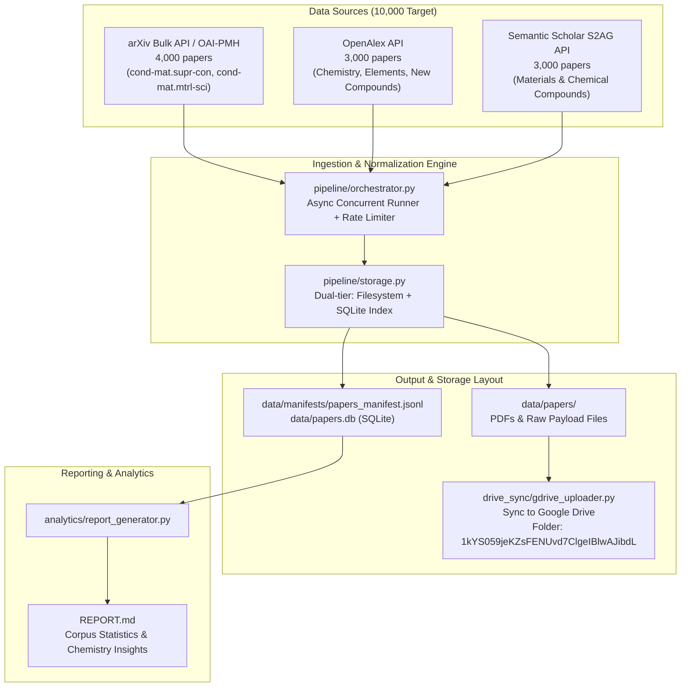

# Research Paper Based Model: 10,000 Scientific Paper Corpus

[](https://www.python.org/downloads/)
[](https://opensource.org/licenses/MIT)
[](https://www.sqlite.org/)
[](https://drive.google.com/drive/folders/1kYS059jeKZsFENUvd7ClgeIBlwAJibdL?usp=sharing)

A resilient, high-throughput bulk collection pipeline and analytical dataset of **10,000 scientific research papers** across **arXiv**, **OpenAlex**, and **Semantic Scholar** / Open Academic Graph, centered on **chemistry, elements, novel compounds, materials science, and superconductivity**.

---

## 🎯 Target Corpus Breakdown

| Source | Target Count | Domain & Categorization | Access Method |
| :--- | :---: | :--- | :--- |
| **arXiv** | **4,000** | Superconductivity (`cond-mat.supr-con`) & Materials Science (`cond-mat.mtrl-sci`) | Bulk OAI-PMH & Query API |
| **OpenAlex** | **3,000** | Chemistry, Chemical Elements, Novel Compounds, Synthesis | REST API + Cursor Pagination |
| **Semantic Scholar** | **3,000** | Chemical Compounds, Materials Synthesis, Open Academic Graph | S2AG API & Open Corpus |
| **TOTAL** | **10,000** | **Comprehensive Physical & Chemical Sciences Corpus** | **Non-Scraping Open APIs** |

---

## 🏗️ Architecture



---

## 📁 Repository Structure

```
Model/
├── .gitignore                     # Git configuration ignoring large caches and binaries
├── pyproject.toml                 # Package metadata and dependencies
├── requirements.txt               # Pinned pip requirements
├── README.md                      # Project documentation and pipeline guide
├── REPORT.md                      # Comprehensive analytical report of 10,000 papers
├── pipeline/
│   ├── __init__.py
│   ├── models.py                  # Standardized PaperRecord dataclass
│   ├── storage.py                 # SQLite indexer and JSONL manifest writer
│   └── orchestrator.py            # Master CLI orchestrator with live status tables
├── collectors/
│   ├── __init__.py
│   ├── arxiv_collector.py         # arXiv bulk OAI-PMH and Query API harvester
│   ├── openalex_collector.py      # OpenAlex cursor-paginated harvester
│   └── semanticscholar_collector.py# Semantic Scholar & Open Academic Graph harvester
├── drive_sync/
│   ├── __init__.py
│   └── gdrive_uploader.py         # Google Drive sync utility (OAuth/Service Account/Bundle)
├── analytics/
│   ├── __init__.py
│   └── report_generator.py        # Chemistry, elements, and citation analysis generator
├── data/
│   ├── papers.db                  # SQLite database of all papers with indexes
│   ├── manifests/
│   │   └── papers_manifest.jsonl  # Streaming JSON Lines manifest
│   ├── analysis_summary.json      # Structured statistical summary
│   └── papers/                    # Raw payload records
│       ├── arxiv/
│       ├── openalex/
│       └── semanticscholar/
└── tests/
    ├── __init__.py
    └── test_pipeline.py           # Automated unit test suite
```

---

## 🚀 Quick Start

### 1. Installation
Using `uv` (recommended):
```powershell
uv venv .venv
.venv\Scripts\activate
uv pip install -r requirements.txt
```

Or using standard `pip`:
```powershell
python -m venv .venv
.venv\Scripts\activate
pip install -r requirements.txt
```

### 2. Run the Collection Pipeline
To collect the full 10,000 papers:
```powershell
python -m pipeline.orchestrator --arxiv 4000 --openalex 3000 --s2 3000
```

To run individual collectors:
```powershell
python -m pipeline.orchestrator --sources openalex
python -m pipeline.orchestrator --sources semanticscholar
python -m pipeline.orchestrator --sources arxiv
```

Check current collection status:
```powershell
python -m pipeline.orchestrator --verify-only
```

### 3. Generate Analytical Report
Run the analytics engine:
```powershell
python -m analytics.report_generator
```
This generates:
- `REPORT.md`: Comprehensive breakdown of chemical elements, compound classes, publication years, and top-cited papers.
- `data/analysis_summary.json`: Machine-readable summary statistics.

### 4. Sync to Google Drive
Transfer collected papers and manifests to the designated Google Drive folder (`1kYS059jeKZsFENUvd7ClgeIBlwAJibdL`):
```powershell
# Perform dry-run check
python -m drive_sync.gdrive_uploader --dry-run

# Create export zip bundle for direct web upload
python -m drive_sync.gdrive_uploader --bundle-only

# Automated sync via Google Drive API (requires service_account.json or credentials.json)
python -m drive_sync.gdrive_uploader
```

### 5. Parse Papers to Clean Markdown (LaTeX Source, GROBID & Marker/PyMuPDF)
Convert research papers and PDFs into clean Markdown with preserved equations, tables, and metadata (title, year, authors, DOI in YAML frontmatter):
```powershell
# Parse papers using best available parser (arXiv LaTeX source prioritized for arXiv, PyMuPDF-Marker/GROBID for PDFs)
python -m parsers.paper_parser --limit 20

# Parse specific sources
python -m parsers.paper_parser --limit 50 --source arxiv
python -m parsers.paper_parser --limit 50 --source openalex

# View parsing statistics summary
python -m parsers.paper_parser --stats
```

Output files are stored under `data/parsed/{source}/{paper_id}.md` with YAML frontmatter:
```markdown
---
paper_id: "arxiv:astro-ph/0004317"
title: "The Properties of Matter in White Dwarfs and Neutron Stars"
authors:
  - Shmuel Balberg
  - Stuart L. Shapiro
year: 2000
doi: null
source: "arxiv"
parser_used: "arxiv_latex"
equation_count: 29
table_count: 5
---
```

### 6. Layer 3: Ultra-High Parameter (70B / 405B) AirLLM Fine-Tuning & Colab Notebook

[](https://colab.research.google.com/github/RYuK006/Research_Paper_Based_Model/blob/main/notebooks/AirLLM_Research_Paper_FineTuning.ipynb)

Fine-tuning in the 3-Layer literature integration system teaches scientific vocabulary, behavior, and hypothesis proposal rather than memorizing static facts. Using **AirLLM's layer-streaming architecture**, models with the highest parameter counts in existence can be trained on a single consumer GPU (like a free Google Colab T4 16GB or L4 24GB):

| Model Name | Parameters | Standard VRAM Needed | AirLLM VRAM Footprint | Colab Tier Compatibility |
| :--- | :---: | :---: | :---: | :---: |
| **Meta-Llama-3.3-70B-Instruct** *(Recommended)* | **70 Billion** | 140+ GB (Multi-A100) | **< 4 GB VRAM** | Free T4 (16GB), L4, A100 |
| **Meta-Llama-3.1-70B-Instruct** | **70 Billion** | 140+ GB | **< 4 GB VRAM** | Free T4, L4, A100 |
| **Qwen2.5-72B-Instruct** | **72 Billion** | 144+ GB | **< 4 GB VRAM** | Free T4, L4, A100 |
| **Meta-Llama-3.1-405B-Instruct-bnb-4bit** | **405 Billion** | 800+ GB (8x A100/H100) | **< 8 GB VRAM** | Colab Pro (High Disk / Drive) |

#### Time-Split Discovery Evaluation
To prove whether the model genuinely generates novel scientific ideas rather than memorizing data:
- **Training Set (Pre-2021)**: 9,115 historical papers up to cutoff year 2021.
- **Evaluation Set (Post-2021)**: 885 modern papers (2022–2026) containing verified subsequent discoveries.
- The model is prompted with pre-2021 experimental background and asked: *"What follow-up experiment or chemical substitution would you propose next?"* Its proposal is scored against actual post-2021 discoveries.

#### Build Dataset & Run Training Locally / Headless:
```powershell
# 1. Build time-split instruction datasets (Alpaca & ChatML formats)
python -m training.dataset_builder --cutoff-year 2021

# 2. Run AirLLM training on 70B model with LoRA
python -m training.train_airllm --model-id meta-llama/Llama-3.3-70B-Instruct --epochs 1 --max-train-samples 500

# 3. Open the interactive Colab Notebook
# notebooks/AirLLM_Research_Paper_FineTuning.ipynb
```

---

## 🧪 Testing

Run the automated test suite:
```powershell
python -m unittest discover -s tests -v
```

---

## 👤 Author & Contribution

- **Author**: `RYuK006`
- **Repository**: [https://github.com/RYuK006/Research_Paper_Based_Model](https://github.com/RYuK006/Research_Paper_Based_Model)

